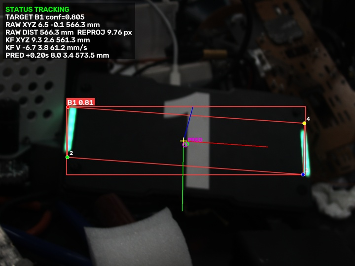

# YOLO 装甲板识别、PnP 位姿解算与卡尔曼滤波

本项目对应“第五次作业：相机标定、PnP 位姿解算与卡尔曼滤波”。程序处理链为：

```text
MVS 工业相机/视频
    → YOLO 四关键点装甲板识别
    → OpenCV solvePnP
    → XYZ、距离和重投影误差
    → 六状态卡尔曼滤波
    → 速度估计与未来 0.2 s 位置预测
    → 视频、CSV、JSON 和代表截图
```

## 当前完成状态

项目已在 Windows 和真实 MVS 工业相机上完成端到端验证：

- 相机棋盘标定脚本。
- PT、ONNX、TorchScript 装甲板四关键点推理。
- 四关键点实体顺序配置与编号检查。
- 装甲板 PnP 位姿解算。
- 连续帧六状态卡尔曼滤波、丢测预测和跳变复位。
- MVS、普通摄像头、视频和图片输入。
- 检测框、类别、置信度、四关键点、坐标轴、XYZ、速度、预测点可视化。
- 视频、逐帧 CSV、汇总 JSON 和代表截图保存。
- 13 项合成/算法测试。
- 使用最终 MVS 相机图片完成真实标定：16/16 张有效，1440×1080，
  26 mm 方格，RMS 约 0.459 px。
- Windows MVS SDK 动态库加载已适配，并成功枚举到相机。当前环境为
  MVS SDK 4.9.0.3，相机 `MV-CS016-10UC`，序列号 `DA4302122`。
- 已用连续真实相机帧确认四关键点顺序、PnP 尺寸和卡尔曼滤波链路。
- 已录制 750 帧、25 秒的最终演示视频，并保存逐帧 CSV、汇总 JSON 和
  代表截图。

## 目录

```text
yolo-camera-pnp-kalman/
├── calibrate.py                  # 棋盘格标定
├── detect_pnp_kalman.py          # 完整实时/离线处理程序
├── camera_preview_server.py      # 浏览器实时相机预览，便于对焦和构图
├── armor_predictor.py            # PT/ONNX 四关键点推理
├── armor_core.py                 # 前处理、ONNX 解码、NMS、绘制
├── pose_math.py                  # 标定参数、角点顺序与 solvePnP
├── kalman_tracker.py             # 六状态卡尔曼滤波
├── mvs_camera/                   # 海康 MVS 相机取流和资源释放
├── configs/
│   ├── assignment.json           # 作业默认参数
│   └── camera_params.example.json
├── models/                       # 本地放 best.pt，不提交
├── data/                         # 本地放视频，不提交
├── results/                      # 运行输出，不提交
├── docs/                         # README 使用的真实结果截图
└── tests/                        # 无相机测试
```

## 1. 运行环境和依赖

推荐环境：

- Python 3.10～3.12。
- 本项目已在 Windows、Python 3.14、OpenCV 5.0、Ultralytics CPU 环境做过基础验证。
- 当前 Windows 验证环境：Python 3.14、OpenCV 5.0.0、NumPy 2.5.4、
  PyTorch 2.14.1+cpu、Ultralytics 8.4.175、MVS SDK 4.9.0.3。
- 作业允许 CPU 或 GPU；默认使用 CPU。
- MVS 相机需要另外安装海康 MVS SDK，本项目不会自动安装厂商 SDK。

Windows PowerShell 安装：

```powershell
cd D:\ChatGPT\yolo-camera-pnp-kalman
py -m venv .venv
.\.venv\Scripts\Activate.ps1
python -m pip install --upgrade pip
pip install -r requirements.txt
```

如果 PowerShell 阻止激活虚拟环境，可以只执行：

```powershell
Set-ExecutionPolicy -Scope Process Bypass
.\.venv\Scripts\Activate.ps1
```

Ubuntu 安装 Python 依赖：

```bash
cd yolo-camera-pnp-kalman
python3 -m venv .venv
source .venv/bin/activate
python -m pip install --upgrade pip
pip install -r requirements.txt
```

Ubuntu 还需要安装海康 MVS SDK。如果程序找不到动态库，可指定：

```bash
export MVS_SDK_LIBRARY=/opt/MVS/lib/64/libMvCameraControl.so
```

## 2. 准备模型

把教师提供的 `best.pt` 放在：

```text
D:\ChatGPT\yolo-camera-pnp-kalman\models\best.pt
```

Ubuntu 对应：

```text
yolo-camera-pnp-kalman/models/best.pt
```

本模型输出 6 类：`B1/B2/B3/R1/R2/R3`，每类目标有 4 个二维关键点。
模型文件不提交 Git；README、命令行参数和配置都可以替换模型路径。

## 3. 用最终相机完成标定

你现有的棋盘可以检测出 **9×6 个内角点**，因此标定参数应写：

```text
--pattern 9 6
```

注意“9×6”是内角点数量，不是黑白方格总数。还需要用尺子量出每个方格的
实际边长。本项目最终实测为 **26 mm**。

必须用最终推理所用的同一台相机、同一分辨率、同一像素格式拍摄。手机照片
只能证明棋盘可用，不能把手机标定参数用于 MVS 相机。

拍摄建议：

1. 固定曝光和焦距，不要让相机自动曝光、自动对焦。
2. 拍 15～25 张，棋盘完整出现。
3. 棋盘占画面约三分之一到三分之二。
4. 棋盘覆盖中心、四角、远近和不同倾斜角度。
5. 避免运动模糊、反光和过度过曝。
6. 所有图片最好保持同一横竖方向。

运行标定：

```powershell
python calibrate.py `
  --image-dir C:\Users\LX\MVS\Data `
  --pattern 9 6 `
  --square-mm 26 `
  --detection-mode robust `
  --output configs\camera_params.json
```

如果不是在当前电脑上复现，把 `--image-dir` 改成自己的 MVS 标定图片目录。
如果 4K 图片很多且画面很清晰，可以改用 `--detection-mode fast` 节省时间。

输出：

- `configs/camera_params.json`：内参、畸变、RMS、每张图误差和图像分辨率。
- `results/calibration_previews/`：角点检测预览。

一般希望 RMS 小于 1 px；1～2 px 也可以作为本次作业的起点。RMS 大时应检查
角点误检、图片模糊、角点不全和混合分辨率。

标定脚本会自动按图片分辨率分组。多个分辨率同时存在时，它只选择成功图片
最多的一组，并在终端显示警告。

本项目当前真实标定数据：

```text
相机图片：C:\Users\LX\MVS\Data
图片格式：BMP
分辨率：1440×1080
棋盘内角点：9×6
方格边长：26 mm
有效图片：16 / 16
RMS：0.4591 px
单张误差范围：0.3587 ~ 0.6067 px
```

程序已成功读取 [configs/camera_params.json](configs/camera_params.json)。

本次已识别的相机信息：

```text
相机型号：MV-CS016-10UC
序列号：DA4302122
固件版本：V2.1.4 230927 1116552
MVS SDK：4.9.0.3
```

运行程序前应关闭 MVS 客户端中的实时取流。MVS 客户端即使停在主界面，也可能
以独占方式占用相机，此时程序会报告 `MV_E_ACCESS_DENIED`。

## 4. 先确认关键点顺序

最终使用真实 MVS 相机画面确认 `best.pt` 的关键点编号为：

| YOLO 关键点编号 | 实体角 |
|---|---|
| 1 | 左上 TL |
| 2 | 左下 BL |
| 3 | 右下 BR |
| 4 | 右上 TR |

因此当前默认参数是：

```text
--corner-order TL,BL,BR,TR
```

其他相机或装甲板方向发生变化时，仍应重新确认。用真实相机运行一次仅检测预览：

```powershell
python detect_pnp_kalman.py `
  --source mvs `
  --model models\best.pt `
  --serial DA4302122 `
  --exposure-us 10000 `
  --gain-db 0 `
  --pixel-format BayerRG8 `
  --preview-only `
  --display `
  --output results\corner_order_check.mp4 `
  --out-scale 0.5
```

Windows 或虚拟机无法显示窗口时，删掉 `--display`；打开生成的
`results/corner_order_check_representative.jpg` 查看编号。

如果编号与上表不同，按“关键点 1、2、3、4 对应的实体顺序”修改
`--corner-order`。本项目在真实画面中使用旧顺序时重投影误差约为 105 px，
改为 `TL,BL,BR,TR` 后恢复正常。

然后量出四个关键点围成的实际平面宽高：

```text
四个关键点矩形宽度 = 224 mm
四个关键点矩形高度 = 54 mm
```

宽高必须与四个关键点对应的物理边缘一致，否则距离和 XYZ 会按比例错误。
本次实测整块装甲板外形约为 `224 × 126 mm`，但模型四个关键点位于左右灯条的
发光端点，因此 PnP 使用四个关键点围成的实际矩形 `224 × 54 mm`。整板外框
尺寸不能直接代入 PnP。

如果不容易实时显示窗口，可单独启动浏览器预览，不运行模型：

```powershell
python camera_preview_server.py --exposure-us 10000 --gain-db 0
```

然后访问 `http://127.0.0.1:8765/`。正式推理前需停止预览，释放相机。

## 5. 完整运行 PnP 与卡尔曼

确认角点顺序、宽高和标定文件后运行：

```powershell
python detect_pnp_kalman.py `
  --config configs\assignment.json `
  --source mvs `
  --model models\best.pt `
  --calibration configs\camera_params.json `
  --serial DA4302122 `
  --exposure-us 10000 `
  --gain-db 0 `
  --pixel-format BayerRG8 `
  --armor-width-mm 224 `
  --armor-height-mm 54 `
  --corner-order TL,BL,BR,TR `
  --pnp-method ippe `
  --prediction-seconds 0.2 `
  --display `
  --output results\demo_final.mp4
```

上面的 `224 × 54` 是本次关键点矩形实测尺寸。`--serial` 可以留空，让程序
按索引选择第一台相机：

```text
--camera-index 0
```

程序运行时应做以下动作：

1. 装甲板静止约 2 秒，让滤波器初始化。
2. 左右平移，观察 XYZ 和速度正负号。
3. 前后移动，观察 Z 和距离变化。
4. 倾斜装甲板，观察坐标轴方向。
5. 短暂遮挡或快速移动，观察漏检时的预测。
6. 按 `q` 正常退出。

输出文件：

```text
results/demo_final.mp4
results/demo_final_tracking.csv
results/demo_final_summary.json
results/demo_final_representative.jpg
```

CSV 包含原始 PnP、滤波后位置、速度、未来预测、距离、重投影误差和四关键点。

## 6. 离线测试

没有相机时，可先用已有视频验证模型：

```powershell
python detect_pnp_kalman.py `
  --source data\test.mp4 `
  --model models\best.pt `
  --preview-only `
  --max-frames 30 `
  --out-scale 0.5 `
  --output results\preview_test.mp4
```

完成后运行单元测试：

```powershell
python -m unittest discover -s tests -v
```

测试覆盖：

- 合成棋盘标定的内参恢复。
- 已知位姿四角点的 PnP 恢复。
- 关键点顺序解析和退化角点拒绝。
- 匀速运动速度估计和未来位置预测。
- 漏检时只预测、不伪造测量。
- 大跳变复位。
- JSON 配置和输出尺寸。

## 7. 主要代码功能

`calibrate.py`

- 用 `findChessboardCornersSB` 搜索 9×6 内角点。
- 兼容旧版 `findChessboardCorners` 与亚像素细化。
- 调用 `cv2.calibrateCamera`。
- 保存内参、畸变、RMS 和单张重投影误差。

`detect_pnp_kalman.py`

- 从 MVS、`opencv:0`、视频或图片读帧。
- 调用 YOLO 得到检测框和 4 个关键点。
- 优先保持上一帧附近的目标，减少多个装甲板之间来回切换。
- 调用 PnP、卡尔曼并生成所有输出文件。

`pose_math.py`

- 把关键点 1～4 映射到 TL、TR、BR、BL 实体角。
- 建立装甲板中心为原点的三维点。
- 调用 `solvePnP`，比较 IPPE 候选解并选重投影最小者。
- 拒绝负深度、异常距离、小面积和高重投影误差。

`kalman_tracker.py`

- 状态向量为 `[x,y,z,vx,vy,vz]`。
- 摄像机坐标系单位是 mm，速度单位是 mm/s。
- 使用真实时间差 `dt` 预测。
- 有 PnP 时修正，漏检时只预测。
- 大跳变和连续异常测量会复位航迹。

`armor_predictor.py`

- `.pt`/`.torchscript` 走 Ultralytics。
- `.onnx` 默认走 ONNX Runtime。

`mvs_camera/`

- 打开海康相机、配置曝光/增益/像素格式、取流。
- 把 BayerRG8 转为 BGR8。
- 异常和退出时释放 SDK 图像缓冲区、停止取流并关闭句柄。

## 8. 参数解释

| 参数 | 当前值 | 作用 |
|---|---:|---|
| `conf` | 0.25 | YOLO 检测置信度 |
| `iou` | 0.7 | NMS IoU 阈值 |
| `imgsz` | 640 | 模型输入尺寸 |
| `armor_width_mm` | 224 mm | PnP 三维模型宽度 |
| `armor_height_mm` | 54 mm | PnP 三维模型高度 |
| `corner_order` | `TL,BL,BR,TR` | YOLO 四个关键点对应的实体角 |
| `pnp_method` | `ippe` | 四点共面目标位姿求解 |
| `process_noise` | 800 mm/s² | 卡尔曼加速度噪声 |
| `measurement_noise` | 25 mm | PnP 测量噪声初值 |
| `gate_threshold` | 25 | 马氏距离平方门限 |
| `jump_reset_mm` | 1000 mm | 明显跳变复位 |
| `prediction_seconds` | 0.2 s | 未来位置预测时间 |
| `target_lost_reset_s` | 1.0 s | 连续丢测多久清除航迹 |

卡尔曼参数是初始值，最终应根据自己整理出的 CSV 调整。轨迹抖动大时，可适当
增大 `measurement_noise`；响应太慢时，可减小它或增大 `process_noise`。

## 9. 真实实验结果与问题记录

最终实验环境：

| 项目 | 实际值 |
|---|---|
| 操作系统 | Windows 11 家庭版中文版，10.0.26200 |
| Python | 3.14.6 |
| OpenCV | 5.0.0 |
| MVS SDK | 4.9.0.3 |
| 推理硬件 | CPU |
| 相机 | MV-CS016-10UC |
| 序列号 | DA4302122 |
| 固件 | V2.1.4 230927 1116552 |
| 输入格式 | BayerRG8 → BGR8 |
| 分辨率 / ROI | 1440×1080 / 全画幅 |
| 曝光 / 增益 | 10000 μs / 0 dB |
| 模型 | `best.pt`，6 类、4 关键点 |
| 关键点顺序 | `TL,BL,BR,TR` |
| 装甲板外形 | 约 224×126 mm |
| PnP 关键点矩形 | 224×54 mm |
| 标定 | 9×6 内角点、26 mm 方格、16/16 张、RMS 0.4591 px |

最终真实相机演示为 750 帧、25 秒：

| 指标 | 结果 |
|---|---:|
| 含检测帧 | 480 / 750（64.0%） |
| PnP 成功帧 | 480 / 750（64.0%） |
| B1 检测框 | 567 个 |
| R1 检测框 | 21 个 |
| 平均检测置信度 | 0.652 |
| 平均重投影误差 | 7.214 px |
| 最大重投影误差 | 19.635 px |
| 有效测量距离范围 | 484.6～693.2 mm |
| 有效测量平均距离 | 559.6 mm |
| 卡尔曼滤波帧 | 549 |
| 卡尔曼复位 | 3 次 |
| 编码前实际处理速度 | 23.5 FPS |
| 平均模型推理 | 17.36 ms/帧 |

真实结果代表帧：



图中包含检测框、类别、置信度、模型输出的四个关键点、相机坐标系、PnP 的
`RAW XYZ`、滤波后的 `KF XYZ`、速度、未来 0.2 s 的预测位置以及重投影误差。
最终视频保存在本地 `results/demo_final_v2.mp4`，约 12.99 MiB，作为作业附件提交，
不进入 Git 历史。

真实问题及处理：

- 混合横竖照片会产生两种分辨率：脚本自动选择成功数量最多的一组，避免把不同
  分辨率混进同一组内参。
- 3000 μs、0 dB 时初始画面几乎全黑，模型无法识别；提高到 10000 μs 后画面
  正常。装甲板灯条未通电时模型同样无法可靠检测，通电点亮后才能稳定工作。
- 真实 MVS 画面确认模型关键点顺序实际为 `TL,BL,BR,TR`；使用旧视频的
  `BL,TL,TR,BR` 时，真实画面重投影误差约 105 px，必须按实体画面改正。
- PnP 尺寸应测量四个关键点围成的灯条端点矩形，而不是整块装甲板外框。
  整板 `224×126 mm` 代入后误差为 57.27 px；改用关键点矩形
  `224×54 mm` 后降到约 3.73 px。
- 前 198 帧装甲板尚未完整进入画面，因此没有检测结果；后续在第 201～209、
  323～330、579～608 和 678～694 帧出现短暂漏检或遮挡。程序保留真实漏检，
  没有伪造测量；连续丢测时卡尔曼先预测，超时后复位。
- 有 21 帧被模型归为 R1，平均置信度约 0.321；主要稳定类别为 B1。该类别
  不一致属于真实模型输出，已保留在 CSV 和结果视频中，没有手工改正。
- 目标过于靠近画面边缘时，`cv2.drawFrameAxes` 提示坐标轴端点超出画面；这是
  可视化截断警告，不影响已经通过重投影检查的位姿数据。
- 画面同时出现多个装甲板时，高置信度目标可能切换：程序加入上一帧位置邻近
  约束；仍无法连续时，卡尔曼会拒绝异常测量并复位。
- 全片没有检测时，检查模型路径、视频路径、`--conf`、曝光和画面亮度；先用
  `--preview-only` 排除推理问题。
- 标定分辨率与输入帧不一致时程序拒绝运行，避免用错内参。
- OpenCV 5 在绘制 `findChessboardCornersSB` 返回的 `float64` 角点时曾触发
  `drawChessboardCorners` 断言；已在绘制前显式转换为连续 `float32` 并重新验证。
- 当前 Windows SDK 的动态库实际名为 `MVCameraControl.dll`，位于
  `C:\Program Files (x86)\Common Files\MVS\Runtime\Win64_x64`，旧代码按
  `MvCameraControl.dll` 查找时会失败。程序现已同时兼容两种拼写和公共运行时
  绝对路径；其他电脑仍可用 `MVS_SDK_LIBRARY` 显式指定完整路径。
- 相机能枚举但打不开时，先关闭 MVS 客户端和其他取流程序；若返回
  `MV_E_ACCESS_DENIED`，通常就是设备被独占占用。

## 10. 提交材料

- 推理演示视频：`results/demo_final_v2.mp4`，约 12.99 MiB。
- 逐帧数据：`results/demo_final_tracking.csv`。
- 汇总数据：`results/demo_final_summary.json`。
- 代表截图：`docs/final-representative.jpg`。
- 标定参数：`configs/camera_params.json`。
- 完整源码、依赖、配置和本 README。

模型、原始视频、结果视频、虚拟环境和运行产物均由 `.gitignore` 排除。
